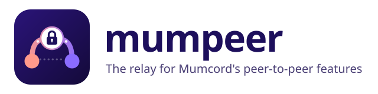
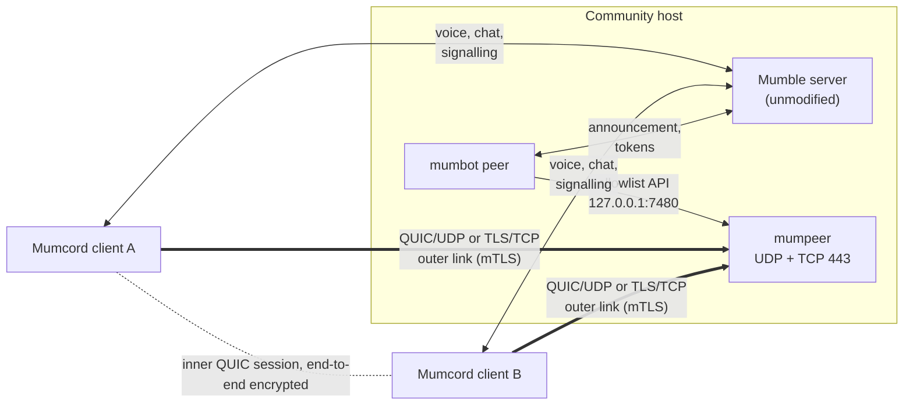

<div align="center">



**Screen sharing and full-size images between Mumcord users, even when NAT, CGNAT or a firewall is in the way, and without showing anyone's IP address to the other person.**

[](https://github.com/Mumcord/mumpeer/actions/workflows/ci.yml)
[](https://github.com/Mumcord/mumpeer/releases)
[](LICENSE)
[](https://github.com/Mumcord/mumpeer/pkgs/container/mumpeer)
<br>
[](Cargo.toml)
[](#releases)

[Quick start](#quick-start) · [Docs](docs/README.md) · [Configuration](docs/configuration.md) · [Operator guide](docs/operator-guide.md) · [FAQ](docs/faq.md)

</div>

## What is mumpeer?

[Mumcord](https://github.com/Mumcord/mumcord) is a modern client for Mumble voice chat. Voice
and text go through the Mumble server as always, but bigger things such as **screen sharing**
and **full-size images** travel directly between two Mumcord users (peer to peer). That saves
the server's bandwidth, but a direct connection does not always work:

- **NAT and carrier-grade NAT (CGNAT):** many home and mobile connections share one public
  address with other customers, so nobody can reach them from outside.
- **Strict firewalls:** office, school and hotel networks often block UDP or everything except
  web ports.
- **Privacy:** a direct connection shows each person's IP address to the other. Some users do
  not want that.

mumpeer is the answer: a small relay server that a community runs next to its Mumble server.
When the direct way fails, or a user chooses to hide their IP address, both Mumcord clients
connect to the relay instead, and it passes their **end-to-end encrypted** packets to each
other, much like a TURN server does for video calls. The relay cannot read or change what it
forwards.

## How it fits together

None of the pieces touches the Mumble server:

| Piece | Role |
| --- | --- |
| **Mumble server** (murmur / mumble-server) | Unmodified. Carries voice, chat and the small signalling messages between clients and the bot. |
| **[mumbot](https://github.com/Mumcord/mumbot) `peer`** | A bot user on the Mumble server. Tells Mumcord clients that the relay exists (address, ports, certificate fingerprint) and asks mumpeer for a short-lived token for each pair of users. |
| **mumpeer** (this repo) | The relay. Accepts only pairs the bot created and forwards packets between exactly those two clients. |
| **[Mumcord](https://github.com/Mumcord/mumcord)** | The client. Tries a direct connection first (unless the user hides their IP), then falls back to the relay. |

Mumcord works fully without bot and relay; they only add a fallback.



1. The bot polls the relay's status and announces it to every Mumcord client that joins.
2. When two users need the relay, one client asks the bot for a token. The bot calls
   `POST /v1/pairs` with both users' certificate hashes and sends the token to both.
3. Both clients connect to the relay with their own Mumble certificate and send the token.
4. The relay answers `ready` to both and from then on copies their packets to each other
   unchanged.

Details: [wire and handshake overview](docs/protocol.md).

## Features

- **Two transports:** QUIC over UDP for speed, TLS over TCP for networks that block UDP. Both
  default to port 443, which almost every network allows. One side may use UDP while the other
  uses TCP.
- **Not an open proxy:** the relay only forwards between the two sides of one pair the bot
  created. It never opens a connection itself.
- **Strong identity checks:** TLS 1.3 only, a client certificate is mandatory, and clients pin
  the relay's certificate by its SHA-256 fingerprint.
- **Short-lived pair tokens:** 256-bit random, valid for 120 seconds by default, usable once
  per side, and bound to the two certificates they were made for.
- **Limits built in:** bandwidth per session and in total, session counts overall and per
  user, new connections and failed handshakes per source address, pairs per minute.
- **Zero setup for identity:** the relay generates its key and self-signed certificate on
  first start and prints the fingerprint; the bot announces it.
- **Small and quiet:** one static Linux binary or a small Docker image, running as a non-root
  user, with minimal logs and nothing about users written to disk.

## Security and privacy

- **End-to-end encryption:** what travels through the relay is an inner QUIC connection
  between the two Mumcord clients, encrypted end to end and pinned to their Mumble
  certificates. A relay that forwarded to the wrong person could not even complete that inner
  handshake.
- **Mutual TLS on the outer link:** every client proves it owns its Mumble certificate; the
  relay identifies it by the certificate hash, the same one the Mumble server uses.
- **Pair tokens:** only the two certificates named in a pair can use its token, each side
  once, within the token lifetime. The relay keeps only a SHA-256 hash of each token.
- **API secret:** at least 32 characters, read from the environment or a file (never from the
  config), compared in constant time, never logged. The API listens on loopback by default.
- **Minimal logs:** no full IP addresses, no full certificate hashes, no tokens, no secret,
  no packet contents. See [what is logged](docs/operator-guide.md#logs).

**What the operator can see.** A relay must know where to send packets, so the person running
it can see the IP addresses of both users in a session, which two certificate hashes talk to
each other, and how much data flows and when. They cannot see the contents. Mumcord tells
users this before they use a relay. Pairs, sessions and counters live in memory only; the only
files the relay writes are its own key and certificate.

More: [Security & privacy](docs/wiki/Security-and-privacy.md).

## Quick start

The fastest way to try mumpeer is the ready-made example in mumbot, which starts a standard
Mumble server, mumpeer and the peer bot side by side:
**[mumbot `examples/peer-with-relay`](https://github.com/Mumcord/mumbot/tree/main/examples/peer-with-relay)**.

### Docker

```sh
mkdir mumpeer && cd mumpeer
# The API secret the bot uses: at least 32 random characters, never in a config file.
openssl rand -hex 32 > api_secret
curl -fsSL -o mumpeer.toml https://raw.githubusercontent.com/Mumcord/mumpeer/main/mumpeer.example.toml
# Set public_host to the DNS name or IP address clients connect to, e.g. relay.example.org.
"${EDITOR:-nano}" mumpeer.toml
# The container runs as uid 10001; only that user may read the secret.
sudo chown 10001 api_secret && sudo chmod 400 api_secret

docker run -d --name mumpeer --restart unless-stopped \
  -p 443:443/udp -p 443:443/tcp \
  -v "$PWD/mumpeer.toml:/config/mumpeer.toml:ro" \
  -v "$PWD/api_secret:/run/secrets/mumpeer_api_secret:ro" \
  -v mumpeer-data:/var/lib/mumpeer \
  ghcr.io/mumcord/mumpeer:0.1.0

docker logs mumpeer 2>&1 | grep fingerprint
# relay fingerprint (SHA-256): 3f…a9
```

Keep the `mumpeer-data` volume: it holds the relay key, and a new key means a new fingerprint,
which clients treat as "the relay changed" until each user trusts it again.

### Docker Compose with mumbot

The bot reaches the API on `127.0.0.1:7480`, so it shares the relay's network namespace and
the API never leaves the pair:

```yaml
services:
  mumpeer:
    image: ghcr.io/mumcord/mumpeer:0.1.0
    restart: unless-stopped
    environment:
      MUMPEER_API_SECRET: ${PEER_API_SECRET:?set PEER_API_SECRET in .env}
    ports: ["443:443/udp", "443:443/tcp"]
    volumes:
      - ./mumpeer.toml:/config/mumpeer.toml:ro
      - mumpeer-data:/var/lib/mumpeer

  mumbot:
    image: ghcr.io/mumcord/mumbot:0.1.0
    command: ["peer"]
    restart: unless-stopped
    network_mode: "service:mumpeer"
    environment:
      MUMBOT_CONFIG: /config/bot.toml
      MUMBOT_PEER_API_SECRET: ${PEER_API_SECRET:?set PEER_API_SECRET in .env}
    volumes:
      - ./bot.toml:/config/bot.toml:ro   # [peer] api_url = "http://127.0.0.1:7480"
      - mumbot-data:/data

volumes:
  mumpeer-data:
  mumbot-data:
```

`MUMPEER_API_SECRET` takes precedence over `api_secret_file`. The bot's own settings (Mumble
server address, server certificate pin, registration) are in
[mumbot's peer documentation](https://github.com/Mumcord/mumbot/blob/main/docs/peer.md); the
complete, tested version of this setup is the
[peer-with-relay example](https://github.com/Mumcord/mumbot/tree/main/examples/peer-with-relay).

### Binary

Download `mumpeer-<version>-linux-x86_64.tar.gz` or `…-linux-aarch64.tar.gz` from the
[releases](https://github.com/Mumcord/mumpeer/releases), check it against `SHA256SUMS`, and
run `mumpeer --config /etc/mumpeer/mumpeer.toml` (or set `MUMPEER_CONFIG`). A systemd unit is
in the [operator guide](docs/operator-guide.md#run-as-a-systemd-service).

## Configuration

One TOML file; only `public_host` is required. Full reference:
[docs/configuration.md](docs/configuration.md). Example:
[`mumpeer.example.toml`](mumpeer.example.toml).

| Key | Default | Meaning |
| --- | --- | --- |
| `public_host` | (required) | DNS name or IP address announced to clients |
| `udp_listen` / `tcp_listen` | `[::]:443` | Relay listeners (QUIC / TLS) |
| `api_listen` | `127.0.0.1:7480` | Allowlist API for the bot |
| `data_dir` | `/var/lib/mumpeer` | Generated relay key and certificate |
| `api_secret_file` | none | File with the API secret (or `MUMPEER_API_SECRET`) |
| `cert_file` / `key_file` | none | Your own certificate and key instead of the generated one |
| `[limits]` | see below | Bandwidth, session and rate limits |

Environment: `MUMPEER_CONFIG` (config path, default `/etc/mumpeer/mumpeer.toml`; the Docker
image sets `/config/mumpeer.toml`), `MUMPEER_API_SECRET`, `RUST_LOG` (default `info`).

## Ports and firewall

| Port | Protocol | Who connects | Open to the internet? |
| --- | --- | --- | --- |
| 443 (`udp_listen`) | UDP (QUIC) | Mumcord clients | **Yes** |
| 443 (`tcp_listen`) | TCP (TLS) | Mumcord clients whose network blocks UDP | **Yes** |
| 7480 (`api_listen`) | TCP (HTTP) | mumbot `peer` only | **No**, keep it on loopback |

- The relay announces the ports it **listens** on. With Docker, publish each port under the
  same number on the host (`443:443`), or clients are sent to the wrong port.
- Already running a web server on TCP 443? mumpeer's TLS needs client certificates and cannot
  be terminated by a reverse proxy. Use another port, or pass the connection through by ALPN;
  see [port 443 and reverse proxies](docs/operator-guide.md#port-443-and-reverse-proxies).
- Some networks filter or throttle UDP 443. The TCP fallback covers that, at a little more
  latency.

## Limits

Defaults are sized for a 2-vCPU VPS with about 50 parallel screen shares:

| Key | Default | Meaning |
| --- | --- | --- |
| `session_mbit` | 10 | Bandwidth per session and direction; above it packets are dropped |
| `total_mbit` | 200 | Bandwidth of all sessions together |
| `max_sessions` | 50 | Sessions at the same time (`relay_full` above) |
| `max_sessions_per_peer` | 4 | Sessions per client certificate (`peer_limit` above) |
| `token_ttl_s` | 120 | Time for both sides to connect with a new token |
| `idle_timeout_s` | 60 | A session without packets ends after this time |
| `max_session_s` | 0 | Maximum session length, 0 = unlimited |
| `conn_per_ip_per_min` | 20 | New connections per source address and minute |
| `failed_per_ip_per_min` | 10 | Failed handshakes or API logins per source address and minute; then blocked for 10 minutes |
| `pairs_per_min` | 120 | Pairs the bot may create per minute |

IPv6 sources are counted per /64. When the bot has not called the API for 90 seconds, new
connections are refused with `bot_gone`, and running sessions end after 60 seconds without
traffic.

## Upgrading

- **Docker:** pull the new tag and recreate the container. Keep the `mumpeer-data` volume, so
  the fingerprint stays the same.
- **Binary:** replace the file and restart the service.
- Running relay sessions end on restart; Mumcord sets up a new one when needed. The bot sees
  the new `boot_id` and announces the relay again.
- The config rejects unknown keys, so read [`CHANGELOG.md`](CHANGELOG.md) before upgrading.

## Releases

Each version is published as static Linux binaries (x86_64 and aarch64) with `SHA256SUMS` on
the [releases page](https://github.com/Mumcord/mumpeer/releases), and as a multi-arch Docker
image:

```sh
docker pull ghcr.io/mumcord/mumpeer:0.1.0
```

`latest` follows the newest stable version; pre-releases (`-rc.N`) never move it. Pin a version
in production.

## Development and contributing

```sh
cargo fmt --all --check
cargo clippy --all-targets -- -D warnings
cargo test                      # includes end-to-end relay tests on loopback
docker build -t mumpeer:dev .
```

[`testenv/`](testenv/README.md) starts a local Mumble server, the relay bot and mumpeer, plus
network namespaces that block direct connections or UDP. Never test against public servers or
relays.

Contributions are welcome. Keep changes small and focused, with tests for new logic, and use
[Conventional Commits](https://www.conventionalcommits.org/) (`feat:`, `fix:`, `docs:` …).
User-visible changes get a line in [`CHANGELOG.md`](CHANGELOG.md). The behaviour follows the
relay specification in Mumcord (`specs/04-mumpeer-relay-specification.md`); open an issue
before larger changes.

### Releasing

Maintainers only. A release is built by pushing a version tag; publishing stays a manual step.

1. Set the new version in `Cargo.toml`, run `cargo check` so `Cargo.lock` follows, and move the
   `[Unreleased]` entries in `CHANGELOG.md` under the new version. Merge this to `main`.
2. Tag the merge commit and push the tag: `git tag v0.2.0 && git push origin v0.2.0`.
3. The `Release` workflow checks that the tag matches the Cargo version and points to a commit
   on `main`, builds static Linux binaries (x86_64 and aarch64), and pushes the multi-arch image
   to `ghcr.io/mumcord/mumpeer` with the version tag. Plain versions also move `latest`;
   pre-release tags such as `v0.2.0-rc.1` do not.
4. The workflow creates a **draft** GitHub release with the binaries and `SHA256SUMS`. Review it
   and publish it by hand.

## Licence

GNU Affero General Public License v3.0, see [`LICENSE`](LICENSE).

## Related projects

- **[Mumcord](https://github.com/Mumcord/mumcord):** the modern Mumble client that uses the relay.
- **[mumbot](https://github.com/Mumcord/mumbot):** headless bots for any Mumble server, including
  the `peer` bot that announces mumpeer.
