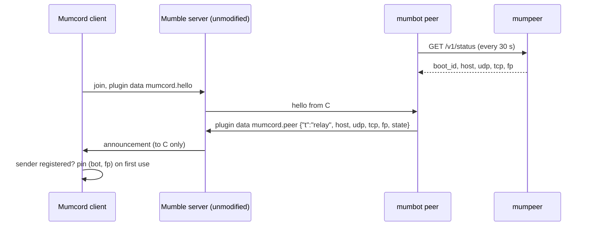
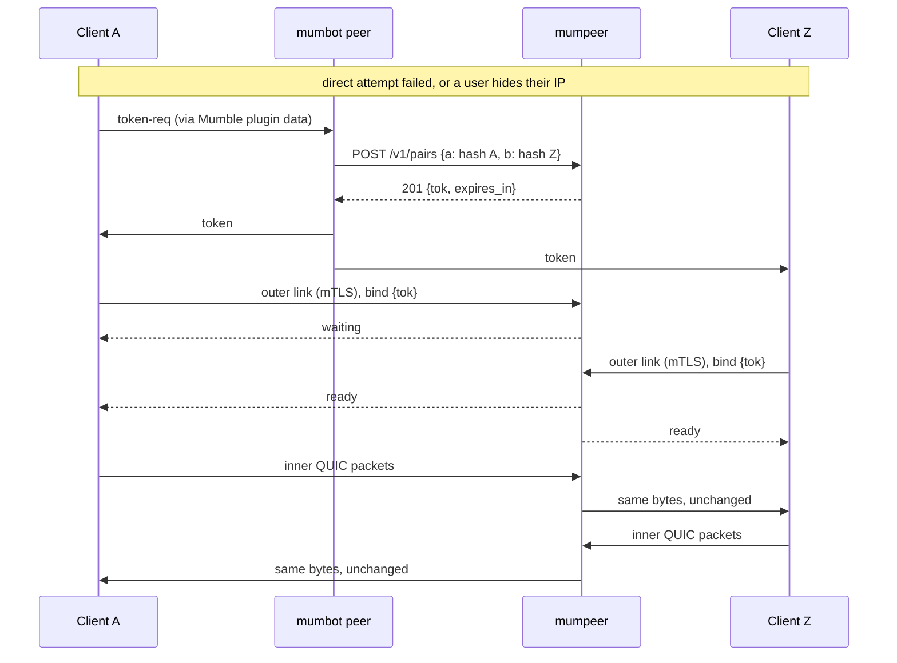

# Wire and handshake overview

How Mumcord clients, the relay bot and mumpeer find each other and set up a relayed
connection. The normative definition is the relay specification in Mumcord
(`specs/04-mumpeer-relay-specification.md`, sections 6.2 to 6.6); this page explains it for
operators and implementers.

## The layers

```text
┌──────────────────────────────────────────────────────────────┐
│ Mumcord P2P features (screen sharing, full-size images)       │
├──────────────────────────────────────────────────────────────┤
│ Inner QUIC connection "mumcord-p2p"                           │  end-to-end between the
│   mutual TLS, pinned to both users' Mumble certificates       │  two clients; the relay
│   fixed 1200-byte packets                                     │  only sees ciphertext
├──────────────────────────────────────────────────────────────┤
│ Outer link to mumpeer (one per client)                        │  client ↔ relay
│   QUIC datagrams over UDP   or   framed TLS 1.3 over TCP      │
│   mutual TLS, ALPN "mumpeer/1", relay pinned by fingerprint   │
└──────────────────────────────────────────────────────────────┘
```

The relay terminates only the **outer** link. It copies each inner packet, byte for byte, from
one side's outer link to the other side's, and never parses it.

## Discovery



The announcement travels as Mumble plugin data, which every standard Mumble server forwards
without understanding it. Mumcord accepts it only from a **registered** user and pins the pair
(bot certificate, relay fingerprint) the first time. A later announcement with a different
fingerprint is not used until the user chooses "Trust new relay". Address and port changes with
the same fingerprint are accepted silently.

## Setting up a relayed session



1. The client opens the outer link over **QUIC on the announced UDP port**. If that has not
   completed after 2 seconds, it starts **TLS on the announced TCP port** in parallel and keeps
   whichever completes first.
2. In the TLS handshake the client presents its **Mumble client certificate** and checks the
   relay certificate against the pinned **SHA-256 fingerprint**. The relay identifies the
   client by its Mumble certificate hash (SHA-1 of the DER, lowercase hex).
3. If that hash is in no current pair, the relay closes the link at once with `not_allowed`.
4. The client sends `bind` with the token. The first side gets `waiting`; when the second
   side binds, both get `ready`.
5. From then on the relay forwards every inner packet to the partner. One side may use UDP and
   the other TCP.

## Outer transport: QUIC over UDP

- QUIC version 1, TLS 1.3, ALPN `mumpeer/1`, client certificate required.
- Datagram extension (RFC 9221) on. Each inner packet is one QUIC datagram.
- Initial outer MTU of 1300 bytes UDP payload, so one inner 1200-byte packet fits into one
  outer datagram. A path that cannot carry that fails the UDP attempt, and TCP takes over.
- Control messages use **one bidirectional stream** opened by the client:
  newline-delimited JSON, at most 512 bytes per message.

## Outer transport: TLS over TCP

- TLS 1.3, ALPN `mumpeer/1`, client certificate required, Nagle off.
- Everything travels in frames:

  ```text
  +--------+----------------+-------------------------+
  | type   | length         | payload                 |
  | 1 byte | 2 bytes (BE)   | 0..1500 bytes           |
  +--------+----------------+-------------------------+
  type 0x00 = control JSON, 0x01 = inner packet
  ```

- A frame longer than 1500 bytes, or a first control frame longer than 512 bytes, closes the
  connection.

## Control messages

| Direction | Message |
| --- | --- |
| client → relay | `{"v":1,"t":"bind","tok":"<43 base64url>"}`: the first and only control message of a client |
| relay → client | `{"v":1,"t":"waiting"}`: this side is bound, the partner is not yet |
| relay → client | `{"v":1,"t":"ready"}`: both sides are bound; inner packets may flow |
| relay → client | `{"v":1,"t":"error","code":"…"}`, then the relay closes the link |

A client must send a valid `bind` within **5 seconds** after the handshake. Packets a client
sends before `ready` are discarded. On QUIC the close reason also carries the error code.

## Error codes

| Code | Meaning | Counts as a failed handshake? |
| --- | --- | --- |
| `unknown_token` | No pair has this token | yes |
| `expired` | The token's lifetime ran out before both sides bound | no |
| `not_allowed` | The certificate is not part of this pair, or this side is already bound | yes |
| `bot_gone` | No API call from the bot for 90 s; the relay accepts no new sessions | no |
| `relay_full` | `max_sessions` reached | no |
| `peer_limit` | This certificate already has `max_sessions_per_peer` sessions | no |
| `rate_limited` | Too many requests. Defined by the protocol; today the relay refuses over-limit sources before the handshake instead | no |
| `version` | Unsupported `v` | yes |
| `bad_request` | Malformed message, wrong ALPN or no client certificate | yes |

Failed handshakes count against `failed_per_ip_per_min`; above it the source address is blocked
for 10 minutes. Connections over `conn_per_ip_per_min` are refused before the handshake.

## Session end

A session ends, and both outer links are closed, when:

| Reason in the log | Cause |
| --- | --- |
| `closed` | Either client closed its outer link |
| `idle` | No packet for `idle_timeout_s` (default 60 s) |
| `revoked` | The bot replaced the pair or called `DELETE /v1/peers/{hash}` |
| `max_duration` | `max_session_s` reached (off by default) |
| `bot_gone` | The bot has been silent for 90 s and the session had no traffic for 60 s |

Mumcord keeps a healthy session busy with the inner connection's keep-alive, so `idle` normally
means a client went away without closing.

## Bandwidth

Each session has a token bucket per direction (`session_mbit`) and all sessions share one
(`total_mbit`). A packet that does not fit is dropped, never queued; the inner QUIC connection
notices the loss and slows down by itself. Bursts of 100 ms worth of traffic (at least 64 KiB)
pass, so a single video key frame is not cut.

Plugin data (a pair with `use = plugin_data`, or a plugin-data broadcast) has the lowest
priority and its own limits from `[plugin_data]`:

- **Per sender:** each side of a plugin-data pair and each publisher of a plugin-data broadcast
  is capped at `max_kbps_per_sender` (default 512 kbit/s, bursts of at least 64 KiB) instead of
  `session_mbit` or `broadcast_in_mbit`.
- **Share:** all plugin data together uses at most `max_share_percent` (default 25 %) of
  `total_mbit`.
- **Lowest priority:** plugin data only gets total bandwidth that leaves half of the total
  burst for everything else, so voice, screen sharing, images and files are never held up by
  it. While the relay is busy with them, plugin data is dropped (from senders) or waits (copies
  to viewers).

## Screen-share and plugin-data broadcasts

A broadcast (Mumcord spec 07, FR-7.41 … FR-7.50) lets one sharer upload a screen share once;
the relay copies it to every admitted viewer. A plugin-data broadcast (Mumcord spec 09,
FR-9.59, `use = plugin_data` in [the API](api.md#broadcasts), `k = plg` between client and bot)
works the same way for one participant sending plugin data to the others in a channel; it
carries `data` units instead of media. The bot creates the broadcast and admits viewers
through the [API](api.md#broadcasts); each side then opens its own outer link (QUIC or TCP, as
above, same mutual TLS) and binds with its token and a role. The publisher's link and every
subscriber's link are independent: there is no pairing and no `waiting` state.

### Bind

| Direction | Message |
| --- | --- |
| client → relay | `{"v":1,"t":"bind","tok":"<43 base64url>","role":"pub"}`: the sharer, with the token from `POST /v1/broadcasts` |
| client → relay | `{"v":1,"t":"bind","tok":"<43 base64url>","role":"sub"}`: a viewer, with the token from `POST /v1/broadcasts/{id}/viewers` |
| relay → client | `{"v":1,"t":"ready"}`: bound; units may flow |
| relay → client | `{"v":1,"t":"error","code":"…"}`, then the relay closes the link |
| relay → client | `{"v":1,"t":"end","reason":"…"}`, then the relay closes the link |

A `bind` without `role` is a pair bind as before; any other `role` value is `bad_request`. Each
token binds once. A subscriber gets nothing until the publisher's next keyframe, so it should
send `keyreq` and `kf` right after `ready`.

Besides the pair codes (`unknown_token`, `expired`, `not_allowed`, `bot_gone`, `version`,
`bad_request`), a broadcast bind can be refused with:

| Code | Meaning | Counts as a failed handshake? |
| --- | --- | --- |
| `use_not_allowed` | The relay does not allow the broadcast's use (`[uses] screen_share` or `[uses] plugin_data` is off) | no |
| `broadcast_full` | The broadcast has all the subscribers it may have | no |
| `not_allowed` | The certificate is not the one the token was issued for, or the token is already bound | yes |

### Units

After `ready`, everything on a broadcast link is a **unit**: a 14-byte clear header followed
by its payload. The layout, the size limits and the test vectors are defined in Mumcord's
`crates/p2p/README.md` (module `mumcord_p2p::broadcast`); mumpeer checks the same vectors.

```text
offset 0  version (1)          offset 5   key id (0 for control)
offset 1  kind: 1 video,       offset 6   sequence, u32 BE (0 for control)
          2 audio, 3 control,  offset 10  payload size, u32 BE
          4 data
offset 2  flags: bit 0 keyframe (video only)
offset 3  temporal layer 0–3 (video only)
offset 4  video: codec 1 VP9, 2 AV1 · audio: 3 Opus · data: 0 ·
          control: 1 keyreq, 2 key, 3 kf, 4 layers, 5 gone, 6 want
```

A `data` unit (test vector `010400000003000000070000015e`: key id 3, sequence 7, 350 bytes)
carries one encrypted plugin message; the relay never sees the plugin or the payload. Its
payload may be at most `max_unit_bytes` plus 64 bytes of encryption overhead (65 600 bytes by
default).

Media and plugin payloads are end-to-end encrypted by the sender and forwarded unchanged; the
relay reads only the header. A unit with an invalid header (unknown version, kind, codec or
control type, flags or layer out of range, a control unit with a key id or sequence, a size out
of range) closes the link, as does a publisher sending media in a plugin-data broadcast or
`data` in a screen share.

How units travel:

- **QUIC:** every unit on its **own unidirectional stream**: open, write header and payload,
  finish. Readers take streams in the order they were opened, so units stay in order. A stream
  carrying more or less than its header announces closes the link. A client may also send a
  small control unit as **one QUIC datagram** (the whole unit, nothing else); the relay itself
  always uses streams, so `key` and `keyreq` are never lost. The relay lets each client have up
  to 64 unidirectional streams open; clients must allow the relay at least as many.
- **TCP:** units form one byte stream, cut into consecutive `0x01` frames of at most 1500
  bytes. A unit may start or end anywhere inside a frame; units are never interleaved. `0x00`
  frames after `bind` are ignored.

### Control flow

| Type | Direction | Payload |
| --- | --- | --- |
| `keyreq` | sub → relay → pub | The subscriber sends an opaque body (≤ 1024 bytes); the publisher receives `slot ‖ body`, where `slot` is the subscriber's u16 (big-endian) |
| `key` | pub → relay → one sub | The publisher sends `slot ‖ body` (body ≤ 1024 bytes); the subscriber in that slot receives `body`. An unknown slot is ignored |
| `kf` | sub → relay → pub | Empty. Forwarded at most once per 2 s per subscriber and once per 500 ms per broadcast; the relay also sends one when a subscriber's queue overflows or an upload was over its limit |
| `layers` | sub → relay | One byte: the highest temporal layer (0–3) this subscriber wants; higher layers are not sent to it |
| `gone` | relay → pub | `slot` of a subscriber that left or was removed, so the publisher can rekey |
| `want` | sub → relay → pub | Camera tile height. The subscriber sends a u16 (big-endian; 180, 360, 540 or 720); the publisher receives `slot ‖ height` (4 bytes), framed like `keyreq`. Forwarded at most once per second per subscriber; excess is dropped. A subscriber's `want` of any other length closes its link. Test vectors: header `0103000006000000000000000002` (from the subscriber), `0103000006000000000000000004` (to the publisher) |

A slot is unique within its broadcast while its subscriber is bound. A subscriber sending
media or `data` closes its link; control types that are not its to send are ignored, as is a publisher
sending `keyreq`, `kf`, `layers`, `gone` or `want`.

### Pacing

Every subscriber has its own small queue, so a slow one never holds up the others (the same
policy as Mumcord's direct fan-out):

- Control units go first, then audio (at most 25 waiting, oldest dropped), then video, then
  plugin data (at most 32 waiting, oldest dropped).
- A video backlog of 3 frames costs the subscriber the highest temporal layer (at most one
  layer per 500 ms); after 3 s of keeping up it gets one layer back.
- At 8 waiting frames the queue is cleared, the subscriber drops to layer 0, gets nothing until
  the next keyframe, and the relay asks the publisher for one.
- Units the publisher sends above `broadcast_in_mbit` (`camera_max_kbps` in a camera broadcast)
  or above `total_mbit` are dropped; subscribers then wait for the next keyframe, which the
  relay requests.
- Copies to subscribers are paced by `broadcast_out_mbit` (all copies of one broadcast) and
  `total_mbit`: a subscriber waits for its share, its queue grows, and it loses layers.
  A unit larger than the burst (a big keyframe) is never cut.
- In a plugin-data broadcast, units the publisher sends above `max_kbps_per_sender`, above the
  plugin-data share or while the relay is busy (see [Bandwidth](#bandwidth)) are dropped; no
  keyframe is involved. Copies to subscribers wait for spare bandwidth within the share.

### End

The relay ends a link with `end` and closes it (on QUIC with application code 0 and the reason
as close reason). When the publisher's link ends, the whole broadcast ends.

| Reason | Cause |
| --- | --- |
| `closed` | The publisher closed its link (sent to subscribers), or a subscriber closed or broke its own link |
| `idle` | No unit from the publisher for `idle_timeout_s` (default 60 s) |
| `deleted` | The bot deleted the broadcast, or removed this viewer |
| `revoked` | The bot dropped the certificate hash (`DELETE /v1/peers/{hash}`), or admitted the viewer again with a new token |

A subscriber that leaves frees its seat; the publisher gets `gone`. The relay logs only the
broadcast id, whether it carried plugin data, the viewer count, bytes, dropped units and the end
reason, never payloads or plugin ids.

## Allowlist API

The bot side of the protocol is documented in the [API reference](api.md).

## Compatibility

- All versioned messages carry `v`. The relay accepts `v = 1` and refuses anything else with
  `version`.
- The Mumble server is never involved beyond forwarding plugin data. No server plugin, no
  config change, no protocol extension.
- Clients without relay support simply ignore the announcement.
