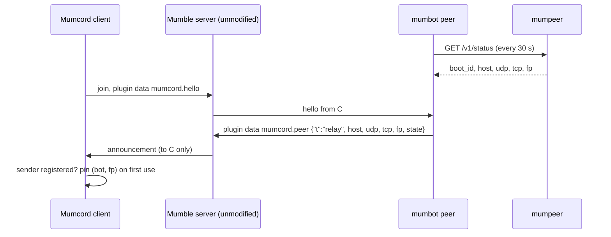
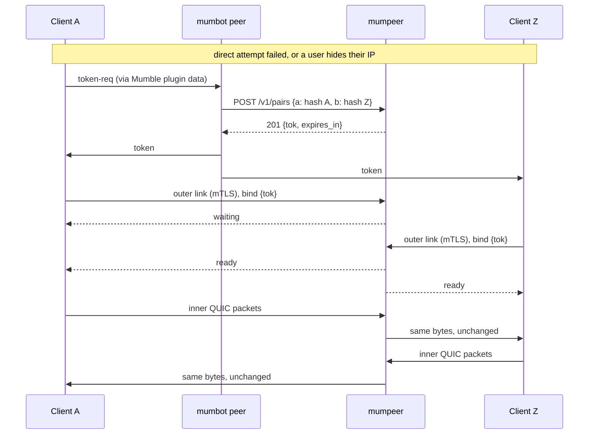

# Wire and handshake overview

How Mumcord clients, the relay bot and mumpeer find each other and set up a relayed
connection. The normative definition is the relay specification in Mumcord
(`specs/04-mumpeer-relay-specification.md`, sections 6.2 to 6.6); this page explains it for
operators and implementers.

## The layers

```text
┌──────────────────────────────────────────────────────────────┐
│ Mumcord P2P features (screen sharing, full-size images)       │
├──────────────────────────────────────────────────────────────┤
│ Inner QUIC connection "mumcord-p2p"                           │  end-to-end between the
│   mutual TLS, pinned to both users' Mumble certificates       │  two clients; the relay
│   fixed 1200-byte packets                                     │  only sees ciphertext
├──────────────────────────────────────────────────────────────┤
│ Outer link to mumpeer (one per client)                        │  client ↔ relay
│   QUIC datagrams over UDP   or   framed TLS 1.3 over TCP      │
│   mutual TLS, ALPN "mumpeer/1", relay pinned by fingerprint   │
└──────────────────────────────────────────────────────────────┘
```

The relay terminates only the **outer** link. It copies each inner packet, byte for byte, from
one side's outer link to the other side's, and never parses it.

## Discovery



The announcement travels as Mumble plugin data, which every standard Mumble server forwards
without understanding it. Mumcord accepts it only from a **registered** user and pins the pair
(bot certificate, relay fingerprint) the first time. A later announcement with a different
fingerprint is not used until the user chooses "Trust new relay". Address and port changes with
the same fingerprint are accepted silently.

## Setting up a relayed session



1. The client opens the outer link over **QUIC on the announced UDP port**. If that has not
   completed after 2 seconds, it starts **TLS on the announced TCP port** in parallel and keeps
   whichever completes first.
2. In the TLS handshake the client presents its **Mumble client certificate** and checks the
   relay certificate against the pinned **SHA-256 fingerprint**. The relay identifies the
   client by its Mumble certificate hash (SHA-1 of the DER, lowercase hex).
3. If that hash is in no current pair, the relay closes the link at once with `not_allowed`.
4. The client sends `bind` with the token. The first side gets `waiting`; when the second
   side binds, both get `ready`.
5. From then on the relay forwards every inner packet to the partner. One side may use UDP and
   the other TCP.

## Outer transport: QUIC over UDP

- QUIC version 1, TLS 1.3, ALPN `mumpeer/1`, client certificate required.
- Datagram extension (RFC 9221) on. Each inner packet is one QUIC datagram.
- Initial outer MTU of 1300 bytes UDP payload, so one inner 1200-byte packet fits into one
  outer datagram. A path that cannot carry that fails the UDP attempt, and TCP takes over.
- Control messages use **one bidirectional stream** opened by the client:
  newline-delimited JSON, at most 512 bytes per message.

## Outer transport: TLS over TCP

- TLS 1.3, ALPN `mumpeer/1`, client certificate required, Nagle off.
- Everything travels in frames:

  ```text
  +--------+----------------+-------------------------+
  | type   | length         | payload                 |
  | 1 byte | 2 bytes (BE)   | 0..1500 bytes           |
  +--------+----------------+-------------------------+
  type 0x00 = control JSON, 0x01 = inner packet
  ```

- A frame longer than 1500 bytes, or a first control frame longer than 512 bytes, closes the
  connection.

## Control messages

| Direction | Message |
| --- | --- |
| client → relay | `{"v":1,"t":"bind","tok":"<43 base64url>"}`: the first and only control message of a client |
| relay → client | `{"v":1,"t":"waiting"}`: this side is bound, the partner is not yet |
| relay → client | `{"v":1,"t":"ready"}`: both sides are bound; inner packets may flow |
| relay → client | `{"v":1,"t":"error","code":"…"}`, then the relay closes the link |

A client must send a valid `bind` within **5 seconds** after the handshake. Packets a client
sends before `ready` are discarded. On QUIC the close reason also carries the error code.

## Error codes

| Code | Meaning | Counts as a failed handshake? |
| --- | --- | --- |
| `unknown_token` | No pair has this token | yes |
| `expired` | The token's lifetime ran out before both sides bound | no |
| `not_allowed` | The certificate is not part of this pair, or this side is already bound | yes |
| `bot_gone` | No API call from the bot for 90 s; the relay accepts no new sessions | no |
| `relay_full` | `max_sessions` reached | no |
| `peer_limit` | This certificate already has `max_sessions_per_peer` sessions | no |
| `rate_limited` | Too many requests. Defined by the protocol; today the relay refuses over-limit sources before the handshake instead | no |
| `version` | Unsupported `v` | yes |
| `bad_request` | Malformed message, wrong ALPN or no client certificate | yes |

Failed handshakes count against `failed_per_ip_per_min`; above it the source address is blocked
for 10 minutes. Connections over `conn_per_ip_per_min` are refused before the handshake.

## Session end

A session ends, and both outer links are closed, when:

| Reason in the log | Cause |
| --- | --- |
| `closed` | Either client closed its outer link |
| `idle` | No packet for `idle_timeout_s` (default 60 s) |
| `revoked` | The bot replaced the pair or called `DELETE /v1/peers/{hash}` |
| `max_duration` | `max_session_s` reached (off by default) |
| `bot_gone` | The bot has been silent for 90 s and the session had no traffic for 60 s |

Mumcord keeps a healthy session busy with the inner connection's keep-alive, so `idle` normally
means a client went away without closing.

## Bandwidth

Each session has a token bucket per direction (`session_mbit`) and all sessions share one
(`total_mbit`). A packet that does not fit is dropped, never queued; the inner QUIC connection
notices the loss and slows down by itself. Bursts of 100 ms worth of traffic (at least 64 KiB)
pass, so a single video key frame is not cut.

## Allowlist API

The bot side of the protocol is documented in the [API reference](api.md).

## Compatibility

- All versioned messages carry `v`. The relay accepts `v = 1` and refuses anything else with
  `version`.
- The Mumble server is never involved beyond forwarding plugin data. No server plugin, no
  config change, no protocol extension.
- Clients without relay support simply ignore the announcement.
