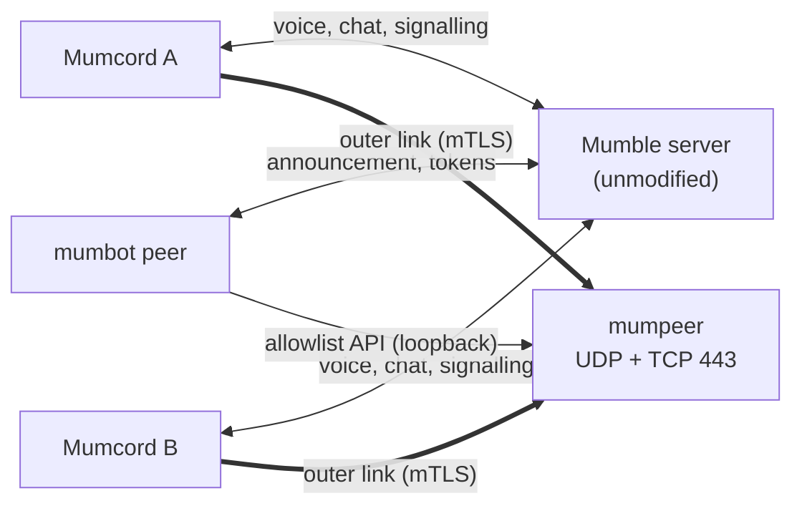

**mumpeer** is a small relay server for [Mumcord](https://github.com/Mumcord/mumcord)'s
peer-to-peer features: screen sharing and full-size images. A Mumble community runs it next to
its Mumble server, together with the relay bot
[`mumbot peer`](https://github.com/Mumcord/mumbot). When two users cannot connect directly
(NAT, carrier-grade NAT, strict firewalls) or a user wants to hide their IP address, both
connect to the relay, and it forwards their end-to-end encrypted packets to each other.

- The **Mumble server stays unmodified**: no plugin, no config change.
- The **relay cannot read** what it forwards; it only sees encrypted bytes.
- It is **not an open proxy**: it forwards only between two users your bot paired.

## Start here

| I want to … | Page |
| --- | --- |
| try it or set it up | [[Getting started]] |
| change ports, limits or the secret | [[Configuration]] |
| run it in production (systemd, Docker, port 443, logs) | [[Operating]] |
| know what it protects and what the operator sees | [[Security and privacy]] |
| fix a problem | [[Troubleshooting]] |
| get a quick answer | [[FAQ]] |

## How the pieces fit

1. The bot announces the relay (address, ports, certificate fingerprint) to Mumcord clients.
2. When two users need it, the bot asks mumpeer for a pair token and sends it to both.
3. Both connect to the relay with their Mumble certificate and the token.
4. The relay forwards their end-to-end encrypted packets, unchanged.

## Reference documentation

The full documentation lives in the repository:
[operator guide](https://github.com/Mumcord/mumpeer/blob/main/docs/operator-guide.md) ·
[configuration reference](https://github.com/Mumcord/mumpeer/blob/main/docs/configuration.md) ·
[bot API](https://github.com/Mumcord/mumpeer/blob/main/docs/api.md) ·
[wire and handshake](https://github.com/Mumcord/mumpeer/blob/main/docs/protocol.md) ·
[troubleshooting](https://github.com/Mumcord/mumpeer/blob/main/docs/troubleshooting.md) ·
[FAQ](https://github.com/Mumcord/mumpeer/blob/main/docs/faq.md)

Licence: AGPL-3.0. Sister projects: [Mumcord](https://github.com/Mumcord/mumcord) (the client)
and [mumbot](https://github.com/Mumcord/mumbot) (bots, including the relay bot).
